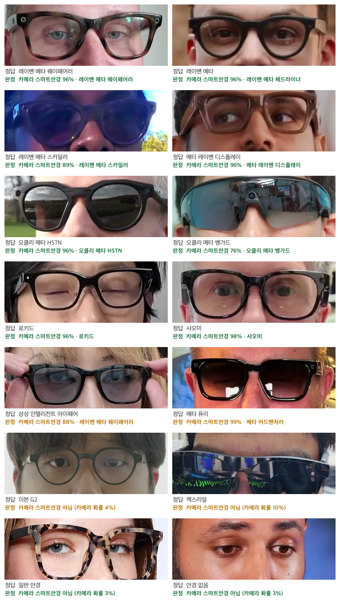
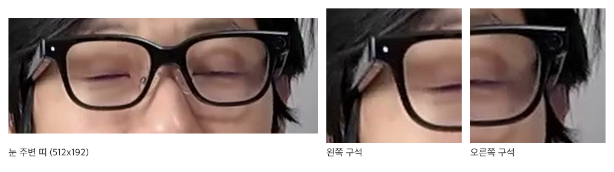
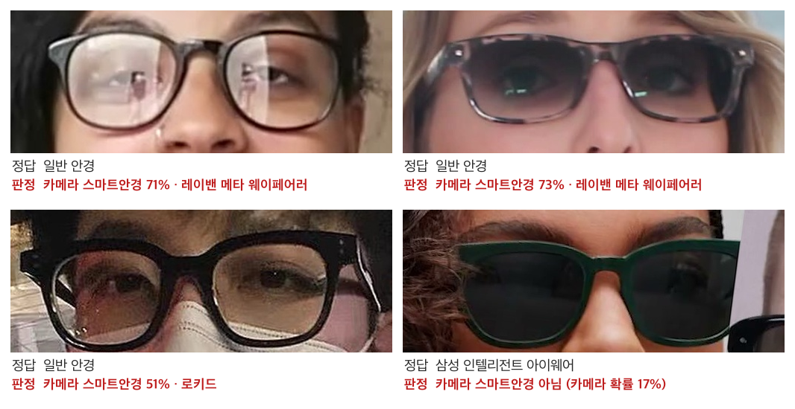

# smartglasses-detect

정면 얼굴 사진에서 카메라 달린 스마트안경을 쓰고 있는지 판별하고, 어느 제품인지 추정하는 모델입니다.

[English](README.md)



위 예시는 모두 학습에 쓰지 않은 테스트 묶음에서 골랐습니다. 초록은 카메라 판정과 제품이 모두 맞은 것이고, 주황은 카메라 판정은 맞았지만 제품이 틀린 것입니다.

## 인식 대상

2026년 11월 기준으로 한국에서 팔리는 카메라 스마트안경 전부를 목표로 합니다.

| 계열 | 제품 | 카메라 판정 | 제품 구분 |
|---|---|---|---|
| 레이밴 메타 | 웨이페어러, 헤드라이너, 스카일러 | 됨 | 됨 |
| 레이밴 메타 | 에비에이터, 제나, 블레이저, 스크라이버 | 됨 | 안 됨 |
| 메타 | 어드밴처러, 퓨리, 노바 | 됨 | 됨 |
| 메타 | 카프리 | 됨 | 안 됨 |
| 메타 레이밴 디스플레이 | 디스플레이 | 됨 | 됨 |
| 오클리 메타 | HSTN, 뱅가드 | 됨 | 됨 |
| 그 밖 | 로키드 글래스, 샤오미 AI 글래스, 삼성 인텔리전트 아이웨어 | 됨 | 됨 |
| 카메라 없음 | 이븐 리얼리티스 G2, 엑스리얼 | "카메라 없는 스마트안경"으로 알림 | 됨 |

제품 구분이 "안 됨"인 제품은 착용 자료가 부족해 제품 이름을 학습하지 못했습니다. 카메라 스마트안경이라는 판정은 내립니다.

## 사용

```sh
git clone https://github.com/fattaillabs/smartglasses-detect
cd smartglasses-detect
python3.12 -m venv .venv && .venv/bin/pip install -r requirements.txt
.venv/bin/python src/detect.py 사진.jpg          # 사진 한 장 또는 폴더
```

```
사진.jpg 얼굴0: 카메라 스마트안경 확률 97.8% → 카메라 스마트안경 (제품 추정 wayfarer 95%)
```

가중치는 `models/release/model.safetensors`(45MB), 설정은 `models/release/config.json` 에 있습니다.

## 방식



1. 얼굴 랜드마크(MediaPipe 478점)로 두 눈을 수평에 맞추고 얼굴 너비를 400픽셀로 통일합니다.
2. 눈 주변 띠(512x192)를 잘라내고, 그 띠의 양쪽 위 구석(카메라와 LED 자리)을 다시 잘라 키웁니다.
3. 띠와 양쪽 구석을 함께 넣는 분류 모델(ResNet18 두 갈래)로 카메라 스마트안경일 확률을 냅니다. 좌우를 뒤집은 것도 함께 보고 평균을 냅니다.
4. 같은 특징에서 제품을 추정합니다. 제품 14종과 "스마트안경 아님"이며 목록은 `labels/products.json` 에 있습니다.

얼굴 전체나 배경을 넣지 않는 이유는, 모델이 안경 대신 사진 출처(조명·화질·배경)를 외우는 것을 막기 위해서입니다.

## 성능

학습에 쓰지 않은 테스트 묶음 1,282장(유튜브 영상 35편의 프레임과 이미지 검색 사진)으로 잰 결과입니다. 판정 기준은 0.5 입니다.

| 구분 | 맞힌 수 |
|---|---|
| 카메라 스마트안경 389장 | 388 |
| 일반 안경 566장 | 563 |
| 안경 없는 얼굴 252장 | 252 |
| 카메라 없는 스마트안경 75장 | 75 (카메라 안경이 아니라고 판정) |
| 전체 1,282장 | 1,278 (99.7%) |

제품별로 카메라 스마트안경임을 알아본 수와, 어느 제품인지까지 맞힌 수입니다.

| 제품 | 카메라 판정 | 제품 구분 |
|---|---|---|
| 레이밴 메타 웨이페어러 | 전부 | 42장 중 41 |
| 레이밴 메타 헤드라이너 | 전부 | 81장 중 67 |
| 레이밴 메타 스카일러 | 12장 중 12 | 12장 중 9 |
| 메타 레이밴 디스플레이 | 14장 중 14 | 14장 중 14 |
| 메타 퓨리 | 20장 중 20 | 20장 중 0 (어드밴처러로 답함) |
| 오클리 메타 HSTN | 47장 중 47 | 47장 중 24 (헤드라이너로 답함) |
| 오클리 메타 뱅가드 | 7장 중 7 | 7장 중 6 |
| 로키드 글래스 | 40장 중 40 | 40장 중 40 |
| 샤오미 AI 글래스 | 20장 중 20 | 20장 중 19 |
| 삼성 인텔리전트 아이웨어 | 23장 중 22 | 23장 중 5 (웨이페어러로 답함) |
| 이븐 리얼리티스 G2 (카메라 없음) | 해당 없음 | 60장 중 38 |
| 엑스리얼 (카메라 없음) | 해당 없음 | 15장 중 5 |

- 새 제품은 제품당 테스트 영상이 한두 편이라 수치가 거칩니다.
- 메타 어드밴처러와 노바는 테스트 영상이 없어 제품 구분을 재지 못했습니다.

테스트 묶음에서 틀린 네 장 전부입니다.



## 한계

- 정면에 가깝고(고개 20도 이내) 얼굴 너비가 200픽셀 이상인 얼굴만 판정합니다. 그 밖은 판정 불가로 처리합니다.
- 삼성 인텔리전트 아이웨어가 가장 어렵습니다. 카메라가 리벳만 한 점이라 일반 뿔테처럼 보입니다. 테스트 묶음에는 카메라가 잘 보이는 장면이 많아, 실제 환경에서는 23장 중 22장보다 낮을 것으로 봅니다.
- 흐린 프레임, 눈을 감은 순간, 어두운 조명의 유광 검은 테에서는 카메라가 묻혀 확률이 낮게 나옵니다.
- 리벳 점이 박힌 두꺼운 뿔테와 렌즈에 조명이 점점이 비친 안경은 오탐이 나기 쉽습니다.
- 새 영상의 정답은 프레임 단위가 아니라 비슷한 프레임 묶음 단위로 붙였습니다. 묶음 안에 다른 장면이 섞이면 정답이 틀릴 수 있습니다.
- 카메라 스마트안경을 썼다는 판정이 촬영 중이라는 뜻은 아닙니다.

## 데이터셋

가공한 학습·테스트 데이터를 [릴리스](https://github.com/fattaillabs/smartglasses-detect/releases)에 압축 파일로 올려 두었습니다. 정렬된 눈 띠 조각(512x192) 22,240장과 정답표입니다. 얼굴 전체나 원본 사진, 영상 프레임은 들어 있지 않습니다. 형식, 출처, 부분별 라이선스는 [DATASET.md](DATASET.md) 에 있습니다.

| 구분 | 출처 | 정답 |
|---|---|---|
| 카메라 스마트안경 | 유튜브 착용 리뷰, 이미지 검색(직접 검수) | 1 |
| 닮은꼴 일반 안경 | 일반 안경 리뷰·시착 영상, 이미지 검색 | 0 |
| 같은 영상의 맨얼굴 | 리뷰어가 안경을 벗은 프레임 | 0 |
| 일반 안경·맨얼굴 | FFHQ와 안경 주석(Zenodo 14252074) | 0 |
| 카메라 없는 스마트안경 | 이븐 리얼리티스 G2, 엑스리얼 리뷰 | 0 |

출처 영상과 이미지 주소 목록은 `sources/` 에, 직접 검수한 결과는 `labels/` 에 있습니다.

## 다시 만드는 순서

```sh
# 1) 수집과 자르기
src/yt_collect.sh rokid <영상ID...>                     # 영상 → 키프레임 → 조각
YT_DEST=yt_test src/yt_collect.sh rokid <영상ID...>     # 테스트 전용 영상
python src/web_collect.py rbmeta "검색어" ...            # aside 브라우저로 이미지 검색
python src/crop.py data/raw/web/rbmeta data/crops/web/rbmeta --label rbmeta
python src/ffhq_fetch.py --glasses 3000 --noglasses 1500

# 2) 정답 붙이기: 영상마다 비슷한 프레임을 묶고 묶음 대표 시트를 보고 판정
python src/cluster_label.py models/release cl5 data/crops/yt/rokid/*
python src/apply_clusters.py cl5

# 3) 목록, 학습, 평가, 그림
python src/build_list.py && python src/build_test_list.py
python src/train.py --list data/train_list.jsonl --out models/run4 --corner band --final --epochs 10 --bs 16 --lr 3e-4 --samples 12000
python src/evaluate.py models/run4 --thr 0.5 --out eval/test_run4.json
python src/export.py models/run4 --thr 0.5
python src/make_figures.py eval/test_run4.json
```

학습은 애플 M1(메모리 16GB)에서 두 시간 반쯤 걸렸습니다.

## 파일

- `src/detect.py` 사진 판정
- `src/crop.py` 정렬, 자르기, 정면 선별
- `src/yt_collect.sh`, `src/web_collect.py`, `src/ffhq_fetch.py` 수집
- `src/cluster_label.py`, `src/apply_clusters.py`, `src/sheet.py` 검수
- `src/build_list.py`, `src/build_test_list.py` 학습·테스트 목록
- `src/train.py`, `src/predict.py`, `src/evaluate.py`, `src/export.py` 학습, 판정, 평가, 내보내기
- `src/gallery.py`, `src/make_figures.py` 결과 갤러리와 이 페이지의 그림

## 라이선스

이 저장소의 모든 것은 비상업 용도로만 쓸 수 있습니다.

| 항목 | 라이선스 |
|---|---|
| 코드, 모델 가중치, 정답표, 그림 | [CC BY-NC-SA 4.0](LICENSE) |
| 데이터셋(릴리스 첨부) | CC BY-NC-SA 4.0, [DATASET.md](DATASET.md) 의 조건 포함 |
| `models/face_landmarker.task` | Apache-2.0, Google (MediaPipe) |

외부 자료와 각각의 라이선스는 [NOTICE.md](NOTICE.md) 에 정리했습니다. 제품 이름과 상표는 각 소유자의 것이며, 이 프로젝트는 어느 회사와도 관계가 없습니다.

## 삭제 요청

데이터셋에는 공개된 영상과 사진에서 잘라낸 눈 주변 조각이 들어 있습니다. 본인이 나오거나 원본의 권리자인데 삭제를 원하면 [이슈](https://github.com/fattaillabs/smartglasses-detect/issues)에 파일 이름이나 원본 주소를 남겨 주십시오. 다음 데이터셋 릴리스에서 뺍니다.
