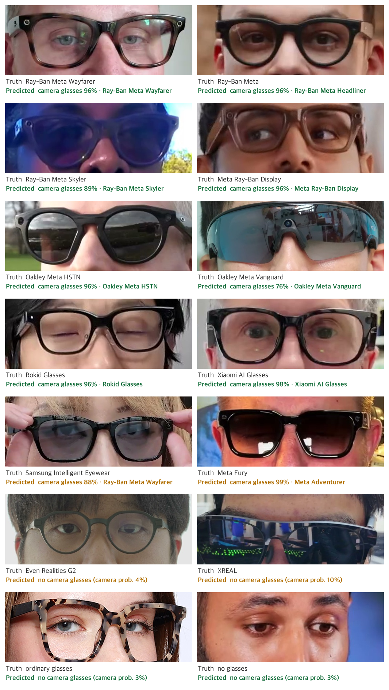
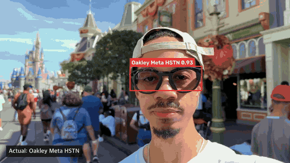
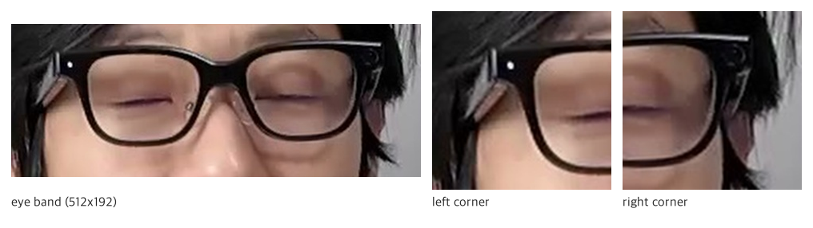
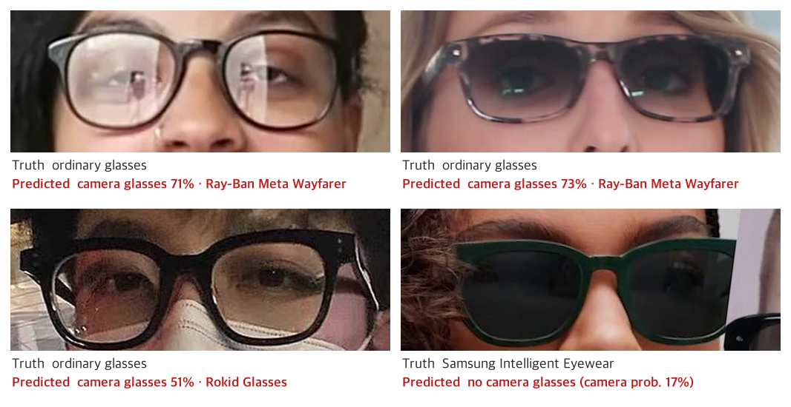

# smartglasses-detect

Tell whether a person in a frontal face photo is wearing camera smart glasses, and estimate which product it is.

[한국어 설명](README.ko.md)



Every sample above comes from the held-out test set. Green means the camera verdict and the product are both right. Orange means the camera verdict is right but the product is wrong.

## Demo

[](docs/demo.mp4)

Eight three-second clips from five videos that were never used for training or testing. Click the image for the full-quality video (27 seconds, no sound). The label at the bottom left is what the person is actually wearing. The box and the name are what the model says frame by frame: red for camera glasses, yellow for smart glasses without a camera, gray for no camera glasses.

The camera verdict is right in all eight clips. The product name is right in four of the five smart glasses clips: the Rokid clip is detected as camera glasses but named Samsung Intelligent Eyewear. Clips were chosen by where a frontal face with glasses is visible, not by whether the model got them right.

| Clip | Source video |
|---|---|
| Oakley Meta HSTN, Ray-Ban Meta Wayfarer | [CEONTHEMAKING, "Ray Ban Meta Gen 2 vs Oakley HSTN: The Truth After 60 Days!"](https://www.youtube.com/watch?v=kfbxKanX5D4) |
| Ordinary glasses | [Brittni D., "Zeelool Glasses Try-On Haul!"](https://www.youtube.com/watch?v=KDBnPk1xEKA) |
| Meta Ray-Ban Display, no glasses | [Ray-Ban \| Meta, "These AI Glasses Will Change Your Life? Meta Ray-Ban Display Review"](https://www.youtube.com/watch?v=aEglZkaLSig) |
| Rokid Glasses, no glasses | [ROAM it RALPH, "Are Smart Glasses Finally Worth Wearing? Rokid AI Glasses"](https://www.youtube.com/watch?v=SSWfdl9MToA) |
| XREAL | [Garett, "Can AR Glasses Replace My Gaming Monitor? XREAL 1 Pro+ Review"](https://www.youtube.com/watch?v=1ZhGa8vGjOQ) |

The clips belong to their creators and are shown here for non-commercial research. To make a demo like this from your own list of videos, see `src/demo_scan.py`, `src/demo_video.py` and `src/demo_reel.py`.

## What it recognizes

The target is every camera smart glasses product sold in South Korea as of November 2026.

| Group | Products | Camera verdict | Product name |
|---|---|---|---|
| Ray-Ban Meta | Wayfarer, Headliner, Skyler | yes | yes |
| Ray-Ban Meta | Aviator, Zena, Blayzer, Scriber | yes | no |
| Meta | Adventurer, Fury, Nova | yes | yes |
| Meta | Capri | yes | no |
| Meta Ray-Ban Display | Display | yes | yes |
| Oakley Meta | HSTN, Vanguard | yes | yes |
| Others | Rokid Glasses, Xiaomi AI Glasses, Samsung Intelligent Eyewear | yes | yes |
| No camera | Even Realities G2, XREAL | reported as "smart glasses without a camera" | yes |

Products marked "no" in the last column had too little wearing footage to learn the product name. They are still detected as camera smart glasses.

## Quick start

```sh
git clone https://github.com/fattaillabs/smartglasses-detect
cd smartglasses-detect
python3.12 -m venv .venv && .venv/bin/pip install -r requirements.txt
.venv/bin/python src/detect.py photo.jpg        # one photo or a folder
```

```
photo.jpg 얼굴0: 카메라 스마트안경 확률 97.8% → 카메라 스마트안경 (제품 추정 wayfarer 95%)
```

The script prints its messages in Korean: the line above reads "face 0: camera smart glasses probability 97.8%, verdict camera smart glasses, product estimate wayfarer 95%". The weights are in `models/release/model.safetensors` (45 MB) and the settings are in `models/release/config.json`.

## How it works



1. MediaPipe face landmarks (478 points) level the eyes and scale the face to a width of 400 pixels.
2. A band around the eyes (512x192) is cut out. The two upper corners of that band, where the camera and the LED sit, are cut again and enlarged.
3. A two-branch ResNet18 reads the band and the two corners and outputs the probability of camera smart glasses. The mirrored input is also evaluated and the two results are averaged.
4. A second output on the same features names the product (14 products plus "not smart glasses", listed in `labels/products.json`).

The model never sees the whole face or the background. This keeps it from memorizing where a photo came from (lighting, compression, backdrop) instead of looking at the glasses.

## Results

Measured on 1,282 held-out samples: frames from 35 YouTube videos and image search photos, none used for training. The threshold is 0.5.

| Group | Correct |
|---|---|
| Camera smart glasses, 389 | 388 |
| Ordinary glasses, 566 | 563 |
| No glasses, 252 | 252 |
| Smart glasses without a camera, 75 | 75 (judged as not camera glasses) |
| All, 1,282 | 1,278 (99.7%) |

Per product: how many were detected as camera smart glasses, and how many got the right product name.

| Product | Detected | Product name |
|---|---|---|
| Ray-Ban Meta Wayfarer | all | 41 of 42 |
| Ray-Ban Meta Headliner | all | 67 of 81 |
| Ray-Ban Meta Skyler | 12 of 12 | 9 of 12 |
| Meta Ray-Ban Display | 14 of 14 | 14 of 14 |
| Meta Fury | 20 of 20 | 0 of 20 (answered Adventurer) |
| Oakley Meta HSTN | 47 of 47 | 24 of 47 (answered Headliner) |
| Oakley Meta Vanguard | 7 of 7 | 6 of 7 |
| Rokid Glasses | 40 of 40 | 40 of 40 |
| Xiaomi AI Glasses | 20 of 20 | 19 of 20 |
| Samsung Intelligent Eyewear | 22 of 23 | 5 of 23 (answered Wayfarer) |
| Even Realities G2 (no camera) | not applicable | 38 of 60 |
| XREAL (no camera) | not applicable | 5 of 15 |

- Newer products have only one or two test videos each, so their numbers are rough.
- Meta Adventurer and Meta Nova have no test video, so their product naming was not measured.

All four mistakes on the test set:



## Limitations

- Only faces that are close to frontal (within 20 degrees) and at least 200 pixels wide are judged. Others are reported as not judgeable.
- Samsung Intelligent Eyewear is the hardest product. Its camera is a dot the size of a rivet, so it looks like ordinary thick-rimmed glasses. The test set contains many frames where the camera is clearly visible, so the real-world rate is probably lower than 22 of 23.
- Blurry frames, closed eyes and glossy black frames in dim light hide the camera and lower the probability.
- Thick frames with rivet dots, and lenses that reflect point lights, tend to cause false alarms.
- Labels for the newer videos were assigned per cluster of similar frames, not per frame. A cluster that mixes scenes can carry a wrong label.
- A positive verdict means the person wears camera smart glasses. It does not mean they are recording.

## Dataset

The processed training and test data is attached to the [releases](https://github.com/fattaillabs/smartglasses-detect/releases) as a zip file: 22,240 aligned eye-band crops (512x192) with labels. It contains no full faces and no original photos or video frames. See [DATASET.md](DATASET.md) for the format, the sources and the license of each part.

| Part | Source | Label |
|---|---|---|
| Camera smart glasses | wearing reviews on YouTube, image search (reviewed by hand) | 1 |
| Look-alike ordinary glasses | glasses reviews and try-on videos, image search | 0 |
| Bare face from the same video | frames where the reviewer took the glasses off | 0 |
| Ordinary glasses and bare faces | FFHQ with the eyeglasses annotations (Zenodo 14252074) | 0 |
| Smart glasses without a camera | Even Realities G2 and XREAL reviews | 0 |

The lists of source videos and image URLs are in `sources/`. The hand-review results are in `labels/`.

## Rebuilding from scratch

```sh
# 1) collect and crop
src/yt_collect.sh rokid <video ids...>                    # video -> key frames -> crops
YT_DEST=yt_test src/yt_collect.sh rokid <video ids...>    # videos reserved for testing
python src/web_collect.py rbmeta "search words" ...       # image search through the aside browser
python src/crop.py data/raw/web/rbmeta data/crops/web/rbmeta --label rbmeta
python src/ffhq_fetch.py --glasses 3000 --noglasses 1500

# 2) label: group similar frames per video, review one sheet per group
python src/cluster_label.py models/release cl5 data/crops/yt/rokid/*
python src/apply_clusters.py cl5

# 3) lists, training, evaluation, figures
python src/build_list.py && python src/build_test_list.py
python src/train.py --list data/train_list.jsonl --out models/run4 --corner band --final --epochs 10 --bs 16 --lr 3e-4 --samples 12000
python src/evaluate.py models/run4 --thr 0.5 --out eval/test_run4.json
python src/export.py models/run4 --thr 0.5
python src/make_figures.py eval/test_run4.json
```

Training took about two and a half hours on an Apple M1 with 16 GB of memory.

## Files

- `src/detect.py` judge a photo
- `src/crop.py` alignment, cropping and the frontal filter
- `src/yt_collect.sh`, `src/web_collect.py`, `src/ffhq_fetch.py` collection
- `src/cluster_label.py`, `src/apply_clusters.py`, `src/sheet.py` hand review
- `src/build_list.py`, `src/build_test_list.py` training and test lists
- `src/train.py`, `src/predict.py`, `src/evaluate.py`, `src/export.py` training, scoring, evaluation, export
- `src/gallery.py`, `src/make_figures.py` result gallery and the figures on this page
- `src/demo_scan.py`, `src/demo_video.py`, `src/demo_reel.py` the demo video

## License

Everything in this repository is for non-commercial use only.

| Item | License |
|---|---|
| Code, model weights, labels, figures | [CC BY-NC-SA 4.0](LICENSE) |
| Dataset (release attachment) | CC BY-NC-SA 4.0, with the conditions in [DATASET.md](DATASET.md) |
| `models/face_landmarker.task` | Apache-2.0, by Google (MediaPipe) |

Third-party materials and their licenses are listed in [NOTICE.md](NOTICE.md). Product names and brands belong to their owners. This project is not affiliated with any of them.

## Removal requests

The dataset contains eye-region crops taken from public videos and photos, and the demo video above shows short clips of public videos. If you appear in it, or you own the source, and you want it removed, open an [issue](https://github.com/fattaillabs/smartglasses-detect/issues) with the file name or the source address. It will be removed from the next dataset release.
